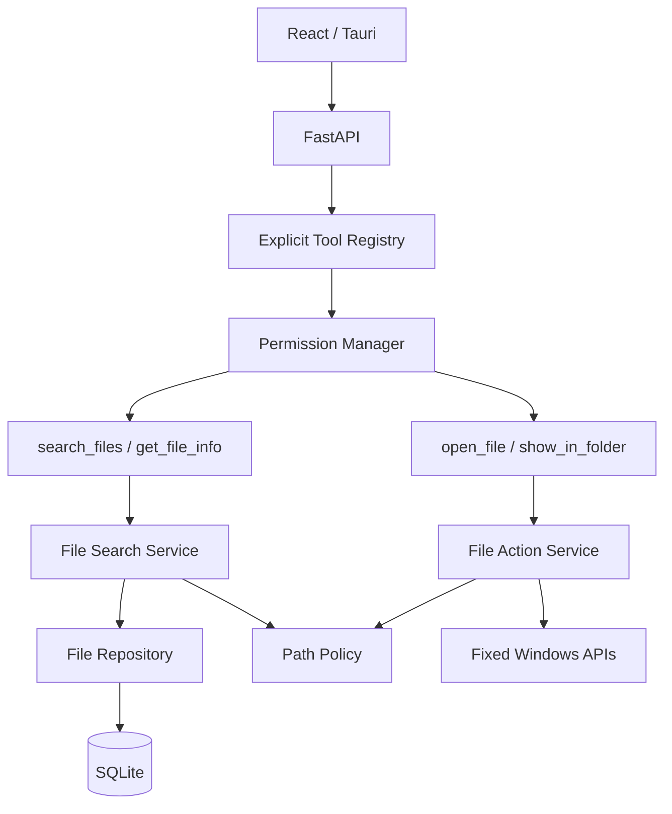
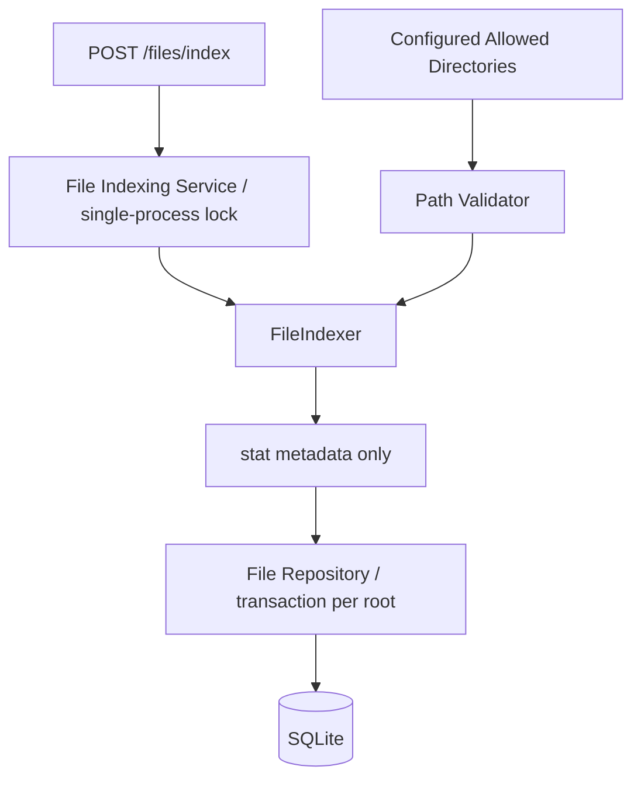
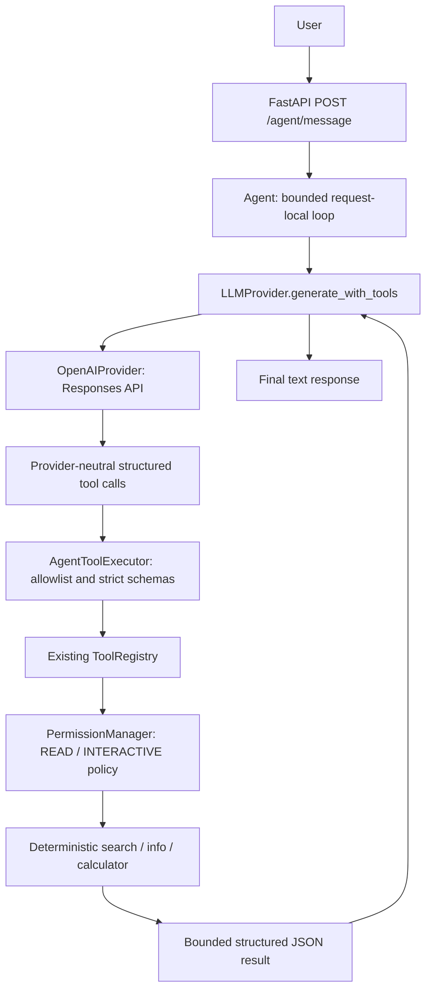

# Architecture

Features 3.2–3.4 connect BRAIN to explicit read-only and guarded interactive HANDS.
GUARD controls every execution and retains the existing path and session boundaries.





## Feature 3.2 provider boundary



`LLMToolDefinition`, `LLMToolCall`, `LLMToolResultMessage`, `LLMReply`, and
`LLMToolTurn` are Nova-owned types. `generate` remains the compatible text-only
method. `generate_with_tools` accepts the original user message, system prompt,
available definitions and completed request-local turns. Legacy text providers
fall back to `generate` and cannot request structured tools.

Only OpenAIProvider translates these types into Responses function definitions and
`function_call_output` items. It preserves call IDs and all assistant output items,
including encrypted reasoning, in an opaque continuation string understood only by
the provider. This is in-memory protocol continuity within one request, not session
memory. SDK objects never leave the provider. `store=False` and encrypted reasoning
inclusion support stateless replay. Remote schemas use `strict=False` to preserve
optional filters/defaults; strict Pydantic JSON validation is enforced locally.
See the [official function-calling protocol](https://developers.openai.com/api/docs/guides/function-calling).

`AgentToolExecutor` is an adapter over the existing registry and permission manager,
not a second registry or search engine. It selects five fixed names and exact
implementation types. Agent schemas narrow existing inputs: search maps `query` to
`q` and caps pages at 50; file IDs are bounded positive integers; arithmetic exposes
only expressions. The direct file API and legacy calculator inputs are preserved.

`create_app` composes one provider, agent and executor per lifespan; shutdown closes
the provider. The SDK client is lazy, async, reused and has no retries. No network or
key is required at startup. Synchronous tools run sequentially through Starlette's
AnyIO-backed bounded threadpool; SQLite connections are opened inside worker calls.

Each request has at most 5 provider iterations, 10 tool calls, and 4 calls per reply.
The last iteration cannot start another tool batch. Arguments are capped at 8 KiB
and results at 16 KiB. Search truncation removes complete records and marks metadata.
A limit response explicitly indicates possible partial completion. Provider timeouts
apply per call. There are no background tasks, session IDs or persisted turns.

Results contain `success`, `data`, `error_code`, `error_message`. Empty search results
are successful empty arrays. Error categories distinguish invalid arguments, unknown
tools, denied permission, missing records, execution/serialization failure and excess
result size. Provider protocol errors remain sanitized HTTP failures. The final HTTP
shape stays `message` with null `result` and `pending_action` placeholders.

The route keeps the existing JSON/origin/body validation. It grants file-tool access
only when the existing managed-session and file-header checks pass. Other requests
still support text/arithmetic, and a model cannot self-authorize file access.

## Composition and reuse

The FastAPI application factory owns settings and composes repositories, PathPolicy,
FileIndexer, FileIndexingService, FileSearchService, and FileActionService at startup.
Tools receive those same services. HTTP search and the AI search_files tool
therefore share one implementation. SQL stays in database modules.

The agent/provider support text and structured tool calling. The speech interface
remains a stub. No voice implementation is added. The only registered tools
are calculate, search_files, get_file_info, open_file, and show_in_folder.

## Guard and user interaction

READ tools execute after schema validation. INTERACTIVE tools return a pending
proposal unless dispatch receives trusted `user_initiated=True`. Only fixed
open/reveal HTTP handlers set this flag; AI reveal may instead use an explicit
backend policy, as described below; it is not a ToolCall argument and cannot
bypass WRITE policy. The user's click is the explicit action authorization in this
phase. WRITE remains pending and DESTRUCTIVE denied. No general confirmation
endpoint exists.

Open/reveal accept stable file IDs, retrieve indexed paths, validate existence and
policy, then invoke two isolated Windows capabilities. Open uses os.startfile with
a fixed open verb and a supported-extension allowlist. Reveal uses SHParseDisplayName
and SHOpenFolderAndSelectItems, not Explorer command-line strings. Both record
request intent in actions before OS dispatch; launch failures are recorded separately.

## Index lifecycle

The index API accepts no caller-selected root. Configured roots are deduplicated
and overlapping children are collapsed. Indexing is manual, synchronous in a FastAPI
worker thread, and serialized with an application-owned lock. Run one Uvicorn worker.
Concurrent refresh gets 409. Search remains available while scanning.

FileIndexer uses an iterative scandir stack. Every traversed path passes centralized
validation; links/reparse points and system paths are skipped. It collects stat
metadata only, excludes Nova's database and SQLite journal files, and never opens
file contents. Failed entries/subtrees are tracked, not silently interpreted as
deletions. A failed root leaves its database records untouched.

One root snapshot and its previous rows are held in memory. One database transaction
per root bulk-upserts records and deletes stale metadata, excluding failed subtrees.
Stale membership uses sets and path ancestry, not pairwise file comparisons.
Unchanged means stored metadata is identical, ignoring the refreshed indexed_at.
Renames get new identities; deletion never deletes a file on disk.
Partial root failures return warnings; complete failure is HTTP 503.

## Database version 2

Startup performs a transactional v1-to-v2 files-table migration. Existing file IDs
and the actions table are retained; a future schema version is rejected.

- Existing metadata fields remain.
- IDs become INTEGER PRIMARY KEY AUTOINCREMENT to avoid stale ID reuse.
- name_key stores Unicode casefolded names for deterministic matching/sorting.
- root_path records the most recent indexing owner.
- path remains unique and uses native canonical paths (case-normalized on Windows).
- Indexes support name sort, extension, modified_at, size, and root_path; the unique
  path index also supports directory range queries.

Repository refresh works by path containment, so reconfiguring overlapping roots
does not duplicate files. Search is parameterized, sort SQL comes from a closed
mapping, and count/page are read in one snapshot transaction. A SQLite callback
checks current path policy before both counting and returning candidates. Search
does no directory enumeration or content reads, though validation performs metadata
checks for candidate paths.

Arbitrary filename substrings use instr over casefolded names; this is a scan of
matching candidates rather than a full-text index. Pagination bounds payload size.
Revoked roots are hidden immediately after restart, even if their rows remain.

## Frontend

Home retains the Nova header, backend status, and disabled future AI command bar.
FileSearch adds a filename form, extension filter, six sorts, page navigation,
refresh statistics, loading/error/empty states, and file cards.
The existing centralized api.ts performs all HTTP calls and supplies the required
file-request header. Formatters handle bytes and locale dates for presentation.
Buttons are disabled during requests; refresh completion reruns the current search.
There is no simulated progress and no filesystem access from React. Tauri starts
the managed backend child and exposes only a restricted command that returns a
per-launch session credential to the main window.

## Platform and deployment limits

Windows Open/Reveal passes through `permissions/windows_handles.py` before native
dispatch. Metadata handles pin each ancestor and target, deny write/delete sharing,
and verify the handle's final path and reparse attributes. They remain held through
dispatch and close on every exit. This does not bind asynchronous viewer access
after dispatch, and does not change the indexer's path-based scanning.

Windows APIs must run in the Windows-native Python process. Linux/WSL open/reveal
return 501, with no shell fallback or path translation. The Tauri host starts
the backend through `backend/managed.py`, owns its lifetime, and exposes only the
`backend_session` command to the trusted main window. Windows GUI behavior must
be tested on Windows; Linux tests mock the OS boundary.

No ORM, background watcher, user login system, or new frontend dependency was
introduced. OpenAI is the optional external text-generation service.


## Feature 3.3: grounded responses

Request → orchestrator → model tool request → registry, validation and permissions
→ deterministic execution → verified result → model response → grounding → response.
Request-local execution records distinguish rejection, start, completion and failure.
The permission manager signals the actual execution start. Records are not persisted.
The existing result envelope gains `status`: SUCCESS, NO_RESULTS, NOT_FOUND,
INVALID_ARGUMENTS, UNKNOWN_TOOL, PERMISSION_DENIED, TOOL_ERROR or
EXECUTION_LIMIT_REACHED. Legacy error_code fields remain compatible. Provider
failures retain sanitized HTTP errors and never retry tools.

File responses use backend-rendered JSON metadata labeled as untrusted data;
multiple total matches ask the user to narrow the request, even with pagination.
Empty pages with nonzero totals are not described as no matches. Failure text is
fixed and sanitized. Calculator prose is retained only for exact verified numeric
answers; other answers use deterministic values. Ordinary text remains available.
A conservative keyword guard blocks common unverified local-action claims in
text-only responses; it is not a general natural-language truth verifier and can
produce false positives or miss paraphrases. Tool-assisted file prose is deliberately
conservative. Indexed metadata can be stale until refresh.

Tool strings remain JSON data, never privileged instructions. The existing exact
tool allowlist, desktop authorization and filesystem policy remain authoritative.
Feature 3.4 extends this boundary as documented below. No frontend, memory or
Features 3.5–3.8 are introduced.
Run `cd backend && .venv/bin/python -m pytest -q` for offline fake-provider tests.
Existing manual commands and provider configuration apply unchanged.

## Feature 3.4 interaction pipeline

```text
User request → Agent → LLM structured call → existing ToolRegistry
→ strict indexed-ID arguments → request-local search selection check
→ PermissionManager (INTERACTIVE)
→ FileActionService / indexed record → canonical path, existence and regular-file check
→ existing extension policy (open only)
→ confirmation-required result OR explicitly authorized reveal
→ existing Windows launcher → verified result → grounded response
```

The permission manager chooses pending versus execution before calling a tool.
Pending interaction requests still run the shared read-only `validate_target`
preflight so invalid records/paths/types are reported instead of inviting confirmation.
Authorized reveal executes through the same tool/service as the direct route, including
immediate path revalidation, Windows handle pinning, and existing action audit writes.
No second launcher, registry, provider or endpoint is introduced.

`NOVA_ALLOW_AGENT_REVEAL` defaults false and is supplied to PermissionManager at
composition. Only trusted executor code supplies `agent_requested`; only direct
file routes supply `user_initiated`. Neither is in the model schema. AI opening
never receives direct-user authorization. PendingAction remains an internal existing
proposal, translated to `CONFIRMATION_REQUIRED`; no persistence or confirmation API
is added. ExecutionRecord adds argument-validation, permission-approval and
confirmation-required flags. `executed` means tool execution started, not OS success.
A completed interaction result means the OS request returned successfully; failed
and pending results cannot produce success prose. Errors remain sanitized.

The exact five-tool allowlist and desktop credential gate are retained. The latest
search must have total=1, one returned row, and an ID matching the interaction.
This conservative backend selection check may ask for a narrower search even where
a human could infer a preference. It uses only the current request's records.
