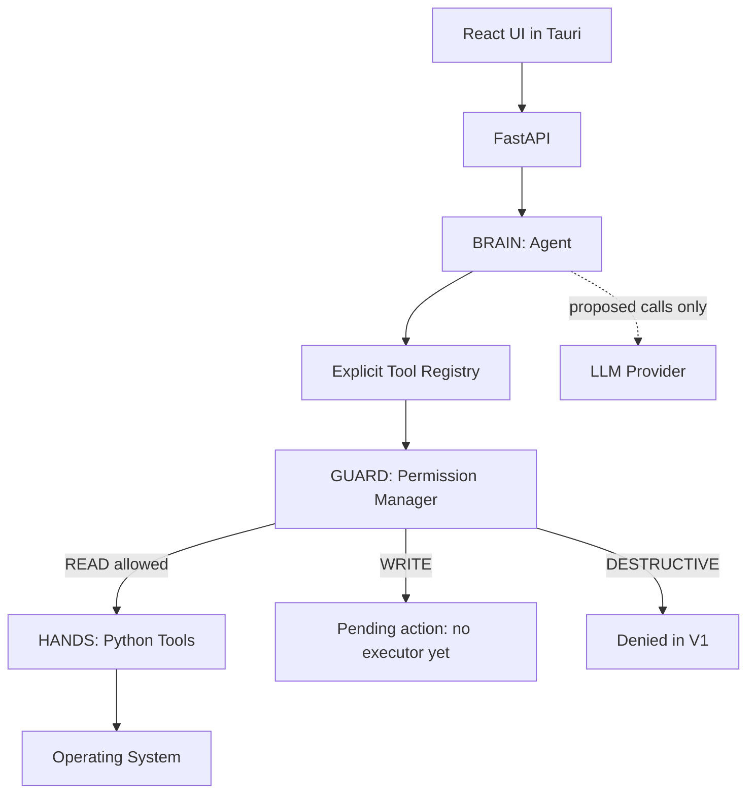

# Architecture

Nova separates reasoning from authorization and execution. FastAPI is the only
backend boundary. The UI never talks directly to tools or the database.

This is the intended application flow. Today only health is wired end to end.
Guarded calculator dispatch works internally and is tested; orchestration and
computer-action HTTP endpoints remain unimplemented.

## Boundaries

- **UI:** React components and a single API client. Status polling has timeouts and
  cancels on unmount. The disabled command controls do not fabricate responses.
- **FastAPI:** validates request models and returns HTTP 501 for unfinished routes.
  The application factory and lifespan own database and tool composition.
- **BRAIN:** `Agent` depends on an `LLMProvider`, registry, and permission manager.
  A future provider returns text or a `ToolCall`. Providers receive descriptions
  of registered tools, never Python callables, OS handles, or SQL connections.
- **Registry:** explicit registration; rejects unknown and duplicate names.
  Only `calculate` is registered at startup.
- **GUARD:** looks up trusted tool risk, validates the input schema, and decides
  execution deterministically. No model-supplied approval/risk fields are accepted.
- **HANDS:** small typed tools; calculator uses explicit arithmetic operations,
  never expression evaluation. Future filesystem tools must validate paths.
- **Storage:** standard-library SQLite with scoped connections, schema bootstrap,
  and parameterized queries in repositories. No ORM. Schema version 1 is recorded;
  add migrations before evolving an existing database.
- **Indexer:** explicit-root skeleton; validates the requested root then raises
  NotImplementedError. No scans or content access occur.
- **Speech:** provider interface only; no microphone acquisition or transcription.

## Contracts and future execution

`AgentRequest` contains the user message. `ToolCall` names a tool and structured
arguments. `ToolResult` distinguishes completed, denied, and error results.
`AgentResponse` can carry a result or `PendingAction`.

A pending action has a generated ID, normalized arguments, registered risk,
creation time, and pending status. It is currently a data contract, not a persisted
authorization grant. There is deliberately no `confirmed=true` execution shortcut.
Before WRITE tools are added, store proposals server-side and bind confirmation to
the exact arguments, user session, expiry, and one-time state transition. Revalidate
the tool and paths immediately before execution. Cancellation must make replay
impossible.

## Prepared tool surface

| Tool | Planned risk | Current implementation |
| --- | --- | --- |
| calculate | READ | Registered, guarded, tested |
| search_files, get_file_info | READ | Module boundary only |
| list_directory | READ | Module boundary only |
| move_file, rename_file, create_folder | WRITE | Module boundary only |
| open_file, show_in_folder | WRITE | Confirmation required; module boundary only |
| delete_file, overwrite_file | DESTRUCTIVE | Not provided; denied by policy |

Opening a file is not inherently harmless: file associations can launch active
content. A later implementation needs additional file-type and target restrictions.

## Lifecycle and deployment

Settings load once per application factory. Startup initializes SQLite under
`data/` by default and composes the calculator guard. Tests inject temporary paths.
No module import scans user directories or contacts a provider.

During development Python and Tauri/Vite are separate processes. Tauri contains
no custom commands or native plugins. No sidecar launcher is included. Native
Windows lifecycle and distribution remain a separate deliverable.

## Deliberate limits

No autonomous loop, memory subsystem, dependency injection framework, ORM,
authentication system, cloud deployment, or background scheduler is included.
The actions repository can store structured audit records, but orchestration must
wire it into proposal/denial/execution transitions before real computer actions ship.
