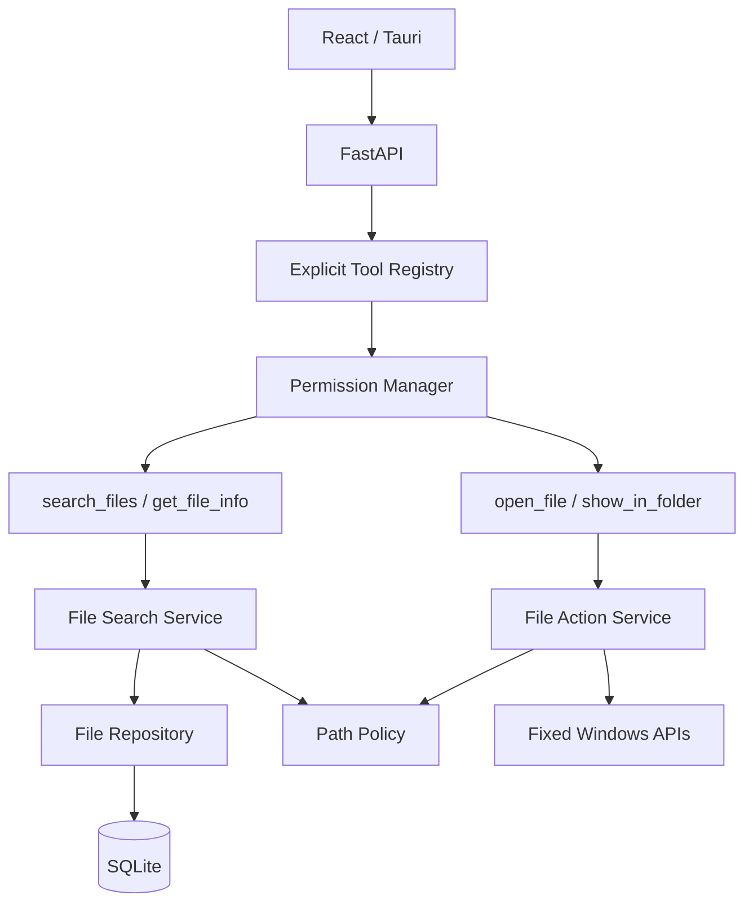
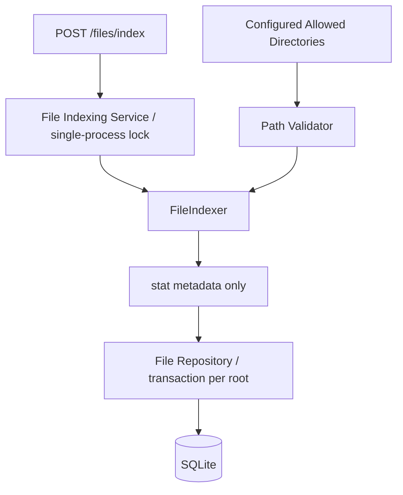
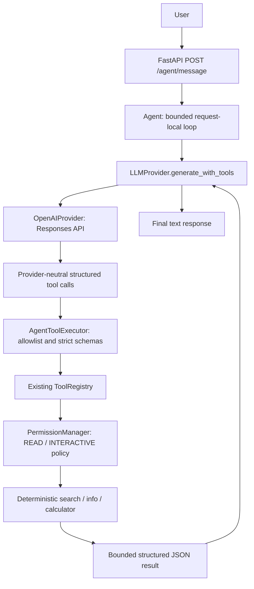

# Architecture

Features 3.2–3.5 connect BRAIN to explicit read-only and guarded interactive HANDS.
GUARD controls every execution and retains the existing path and session boundaries.





## Feature 3.2 provider boundary



`LLMToolDefinition`, `LLMToolCall`, `LLMToolResultMessage`, `LLMReply`, and
`LLMToolTurn` are Nova-owned types. `generate` remains the compatible text-only
method. `generate_with_tools` accepts the original user message, system prompt,
available definitions and completed request-local turns. Legacy text providers
fall back to `generate` and cannot request structured tools.

Only OpenAIProvider translates these types into Responses function definitions and
`function_call_output` items. It preserves call IDs and all assistant output items,
including encrypted reasoning, in an opaque continuation string understood only by
the provider. This is in-memory protocol continuity within one request, not session
memory. SDK objects never leave the provider. `store=False` and encrypted reasoning
inclusion support stateless replay. Remote schemas use `strict=False` to preserve
optional filters/defaults; strict Pydantic JSON validation is enforced locally.
See the [official function-calling protocol](https://developers.openai.com/api/docs/guides/function-calling).

`AgentToolExecutor` is an adapter over the existing registry and permission manager,
not a second registry or search engine. It selects five fixed names and exact
implementation types. Agent schemas narrow existing inputs: search maps `query` to
`q` and caps pages at 50; file IDs are bounded positive integers; arithmetic exposes
only expressions. The direct file API and legacy calculator inputs are preserved.

`create_app` composes one provider, agent and executor per lifespan; shutdown closes
the provider. The SDK client is lazy, async, reused and has no retries. No network or
key is required at startup. Synchronous tools run sequentially through Starlette's
AnyIO-backed bounded threadpool; SQLite connections are opened inside worker calls.

Each request has at most 5 provider iterations, 10 tool calls, and 4 calls per reply.
The last iteration cannot start another tool batch. Arguments are capped at 8 KiB
and results at 16 KiB. Search truncation removes complete records and marks metadata.
A limit response explicitly indicates possible partial completion. Provider timeouts
apply per call. There are no background tasks or durable turns; Feature 3.5 adds bounded session IDs
and in-memory history as described below.

Results contain `success`, `data`, `error_code`, `error_message`. Empty search results
are successful empty arrays. Error categories distinguish invalid arguments, unknown
tools, denied permission, missing records, execution/serialization failure and excess
result size. Provider protocol errors remain sanitized HTTP failures. The final HTTP
shape retains `message` with null `result` and `pending_action` placeholders;
Feature 3.5 adds `conversation_id`.

The route keeps the existing JSON/origin/body validation. It grants file-tool access
only when the existing managed-session and file-header checks pass. Other requests
still support text/arithmetic, and a model cannot self-authorize file access.

## Composition and reuse

The FastAPI application factory owns settings and composes repositories, PathPolicy,
FileIndexer, FileIndexingService, FileSearchService, and FileActionService at startup.
Tools receive those same services. HTTP search and the AI search_files tool
therefore share one implementation. SQL stays in database modules.

The agent/provider support text and structured tool calling. The speech interface
remains a stub. No voice implementation is added. The only registered tools
are calculate, search_files, get_file_info, open_file, and show_in_folder.

## Guard and user interaction

READ tools execute after schema validation. INTERACTIVE tools return a pending
proposal unless dispatch receives trusted `user_initiated=True`. Only fixed
open/reveal HTTP handlers set this flag; AI reveal may instead use an explicit
backend policy, as described below; it is not a ToolCall argument and cannot
bypass WRITE policy. The user's click is the explicit action authorization in this
phase. WRITE remains pending and DESTRUCTIVE denied. No general confirmation
endpoint exists.

Open/reveal accept stable file IDs, retrieve indexed paths, validate existence and
policy, then invoke two isolated Windows capabilities. Open uses os.startfile with
a fixed open verb and a supported-extension allowlist. Reveal uses SHParseDisplayName
and SHOpenFolderAndSelectItems, not Explorer command-line strings. Both record
request intent in actions before OS dispatch; launch failures are recorded separately.

## Index lifecycle

The index API accepts no caller-selected root. Configured roots are deduplicated
and overlapping children are collapsed. Indexing is manual, synchronous in a FastAPI
worker thread, and serialized with an application-owned lock. Run one Uvicorn worker.
Concurrent refresh gets 409. Search remains available while scanning.

FileIndexer uses an iterative scandir stack. Every traversed path passes centralized
validation; links/reparse points and system paths are skipped. It collects stat
metadata only, excludes Nova's database and SQLite journal files, and never opens
file contents. Failed entries/subtrees are tracked, not silently interpreted as
deletions. A failed root leaves its database records untouched.

One root snapshot and its previous rows are held in memory. One database transaction
per root bulk-upserts records and deletes stale metadata, excluding failed subtrees.
Stale membership uses sets and path ancestry, not pairwise file comparisons.
Unchanged means stored metadata is identical, ignoring the refreshed indexed_at.
Renames get new identities; deletion never deletes a file on disk.
Partial root failures return warnings; complete failure is HTTP 503.

## Database version 2

Startup performs a transactional v1-to-v2 files-table migration. Existing file IDs
and the actions table are retained; a future schema version is rejected.

- Existing metadata fields remain.
- IDs become INTEGER PRIMARY KEY AUTOINCREMENT to avoid stale ID reuse.
- name_key stores Unicode casefolded names for deterministic matching/sorting.
- root_path records the most recent indexing owner.
- path remains unique and uses native canonical paths (case-normalized on Windows).
- Indexes support name sort, extension, modified_at, size, and root_path; the unique
  path index also supports directory range queries.

Repository refresh works by path containment, so reconfiguring overlapping roots
does not duplicate files. Search is parameterized, sort SQL comes from a closed
mapping, and count/page are read in one snapshot transaction. A SQLite callback
checks current path policy before both counting and returning candidates. Search
does no directory enumeration or content reads, though validation performs metadata
checks for candidate paths.

Arbitrary filename substrings use instr over casefolded names; this is a scan of
matching candidates rather than a full-text index. Pagination bounds payload size.
Revoked roots are hidden immediately after restart, even if their rows remain.

## Frontend

Home retains the Nova header and backend status, with Chat and Files navigation.
FileSearch adds a filename form, extension filter, six sorts, page navigation,
refresh statistics, loading/error/empty states, and file cards.
The existing centralized api.ts performs all HTTP calls and supplies the required
file-request header. Formatters handle bytes and locale dates for presentation.
Buttons are disabled during requests; refresh completion reruns the current search.
There is no simulated progress and no filesystem access from React. Tauri starts
the managed backend child and exposes only a restricted command that returns a
per-launch session credential to the main window.

## Platform and deployment limits

Windows Open/Reveal passes through `permissions/windows_handles.py` before native
dispatch. Metadata handles pin each ancestor and target, deny write/delete sharing,
and verify the handle's final path and reparse attributes. They remain held through
dispatch and close on every exit. This does not bind asynchronous viewer access
after dispatch, and does not change the indexer's path-based scanning.

Windows APIs must run in the Windows-native Python process. Linux/WSL open/reveal
return 501, with no shell fallback or path translation. The Tauri host starts
the backend through `backend/managed.py`, owns its lifetime, and exposes only the
`backend_session` command to the trusted main window. Windows GUI behavior must
be tested on Windows; Linux tests mock the OS boundary.

No ORM, background watcher, user login system, or new frontend dependency was
introduced. OpenAI is the optional external text-generation service.


## Feature 3.3: grounded responses

Request → orchestrator → model tool request → registry, validation and permissions
→ deterministic execution → verified result → model response → grounding → response.
Request-local execution records distinguish rejection, start, completion and failure.
The permission manager signals the actual execution start. Records are not persisted.
The existing result envelope gains `status`: SUCCESS, NO_RESULTS, NOT_FOUND,
INVALID_ARGUMENTS, UNKNOWN_TOOL, PERMISSION_DENIED, TOOL_ERROR or
EXECUTION_LIMIT_REACHED. Legacy error_code fields remain compatible. Provider
failures retain sanitized HTTP errors and never retry tools.

File responses use backend-rendered JSON metadata labeled as untrusted data;
multiple total matches ask the user to narrow the request, even with pagination.
Empty pages with nonzero totals are not described as no matches. Failure text is
fixed and sanitized. Calculator prose is retained only for exact verified numeric
answers; other answers use deterministic values. Ordinary text remains available.
A conservative keyword guard blocks common unverified local-action claims in
text-only responses; it is not a general natural-language truth verifier and can
produce false positives or miss paraphrases. Tool-assisted file prose is deliberately
conservative. Indexed metadata can be stale until refresh.

Tool strings remain JSON data, never privileged instructions. The existing exact
tool allowlist, desktop authorization and filesystem policy remain authoritative.
Features 3.4 and 3.5 extend this boundary as documented below. Feature 3.6 adds the chat UI below; permanent memory and Features 3.7–3.8 remain outside the implementation.
Run `cd backend && .venv/bin/python -m pytest -q` for offline fake-provider tests.
Existing manual commands and provider configuration apply unchanged.

## Feature 3.4 interaction pipeline

```text
User request → Agent → LLM structured call → existing ToolRegistry
→ strict indexed-ID arguments → request-local search selection check
→ PermissionManager (INTERACTIVE)
→ FileActionService / indexed record → canonical path, existence and regular-file check
→ existing extension policy (open only)
→ confirmation-required result OR explicitly authorized reveal
→ existing Windows launcher → verified result → grounded response
```

The permission manager chooses pending versus execution before calling a tool.
Pending interaction requests still run the shared read-only `validate_target`
preflight so invalid records/paths/types are reported instead of inviting confirmation.
Authorized reveal executes through the same tool/service as the direct route, including
immediate path revalidation, Windows handle pinning, and existing action audit writes.
No second launcher, registry, provider or endpoint is introduced.

`NOVA_ALLOW_AGENT_REVEAL` defaults false and is supplied to PermissionManager at
composition. Only trusted executor code supplies `agent_requested`; only direct
file routes supply `user_initiated`. Neither is in the model schema. AI opening
never receives direct-user authorization. PendingAction remains an internal existing
proposal, translated to `CONFIRMATION_REQUIRED`; no persistence or confirmation API
is added. ExecutionRecord adds argument-validation, permission-approval and
confirmation-required flags. `executed` means tool execution started, not OS success.
A completed interaction result means the OS request returned successfully; failed
and pending results cannot produce success prose. Errors remain sanitized.

The exact five-tool allowlist and desktop credential gate are retained. The latest
search must have total=1, one returned row, and an ID matching the interaction.
This conservative backend selection check may ask for a narrower search even where
a human could infer a preference. It uses only the current request's records.

A subsequent unique search can narrow an earlier ambiguous result. Conversely,
a failed subsequent search or an empty page invalidates selection even when an
earlier search returned one file. The executor checks this before permission
dispatch; rejected selections never reach the OS service. Provider-facing tool
descriptions explain the pending-open and policy-controlled-reveal behavior.

## Feature 3.5 conversation pipeline

```text
User Request + Optional Conversation ID
                ↓
       Session Authorization
                ↓
       Conversation Context
                ↓
       Reference Resolution
                ↓
        Agent Orchestrator
                ↓
       Provider-Neutral LLM
                ↓
         Structured Tools
                ↓
          GUARD Checks
                ↓
       Verified Tool Results
                ↓
      Context State Update
                ↓
       Grounded Response
```

`create_app` owns one `ConversationStore` per lifespan. No schema migration or
permanent chat database is introduced. The existing agent accepts an immutable
context snapshot and a request-local execution-record collector; there is no second
orchestrator. The route uses the existing file-client authorization to select the
managed desktop identity or the explicitly limited standalone identity. A client
cannot supply that identity or select a privilege level through request JSON.

Private sessions track monotonic creation/activity times, a busy flag, numbered
complete turns and a latest `ReferenceSet`. Snapshots contain immutable tuples and
frozen provider-neutral `ConversationTurn` and reference objects. No mutable session
objects, credentials or ownership fields are passed to the provider. A short store
lock protects bookkeeping, never provider/tool work. A busy lease rejects overlapping
turns/clear with 409 and is released on every exit. Different sessions proceed
independently. Expiry is lazy; capacity eviction chooses the oldest idle session of
the same owner, preventing anonymous traffic from evicting managed context.

Defaults: 32 sessions, 30-minute configurable inactivity timeout, 20 messages,
10,000 characters/message, 64 KiB serialized history estimate, 50 references in one
latest set. Whole turns are removed, including their associated references, until
both history budgets fit. A committed turn can be evicted entirely without deleting
its session ID. An oversized assistant response becomes a compact omission/outcome
message. Request-local tool outputs retain the 16 KiB bound; the agent also stops
before another provider call if estimated context exceeds 256 KiB.

`generate_with_context` adds completed exchanges to the provider abstraction while
preserving `generate` and `generate_with_tools`. OpenAI uses native user/assistant
roles; the base compatibility adapter serializes earlier exchanges as untrusted
user-level JSON. System instructions remain separate. Current-request call/output
pairs and opaque provider continuation remain unchanged; neither is retained across
requests. Eviction therefore cannot create orphaned tool messages. Grounded assistant
snapshots contain relevant verified outcomes without needing a historical SDK replay.

Only successful, actually executed `search_files`/`get_file_info` records populate
references. They retain IDs, names, source, source turn and timestamp, not paths or
permission approvals. The tuple order is the tool's returned order and matches the
backend-numbered response. Failed/empty subsequent lookups clear older selections.
A single-row page with a larger total is ambiguous for pronouns. Numeric selections
are page-relative. Reference expiry follows source-turn eviction/session lifecycle.

The narrow resolver produces either clarification or an immutable selected ID and
operation. The latter is an unprivileged provider hint plus an independently enforced
executor constraint. Conflicting file IDs, operation changes, replacement searches
and duplicate interaction attempts fail before GUARD dispatch. Same-request unique
search checks from Feature 3.4 remain in force. No store code performs file operations.

The API adds `conversation_id` to the existing response and an optional request
field. `POST /agent/conversation/clear` removes a validated owned ID. Malformed IDs
are 422; missing/expired/cleared/evicted/wrong-owner IDs are indistinguishable 404s.
Provider errors before tool outcomes roll back the exchange. After outcomes, the
route commits a safe failure exchange, exposes grounded outcomes in error `detail`
and returns `X-Nova-Conversation-ID`. Limits likewise retain and display outcomes;
no tool is retried automatically. Existing response placeholders remain unchanged.

Use one backend worker. Restart loses sessions; no UI storage, login system,
background cleanup, long-term memory or new dependencies are introduced. See README
for configuration and the offline `scripts.check_conversations` walkthrough.


## Feature 3.6 frontend integration

```text
User → React Chat Interface → Typed Frontend API Service
→ Tauri Managed-Session Authentication → FastAPI /agent/message
→ Conversation Context → Agent Orchestrator → LLM Provider
→ Structured Tool Registry → GUARD Authorization
→ Deterministic Backend Services → Verified Tool Results
→ Grounded Agent Response → React Chat Interface
```

Home switches visible Chat/Files views without unmounting them. ChatPanel composes
CommandInput, ChatMessageList and ChatToolStatus; the latter reuses FileResultCard
without interaction controls. useChat owns volatile messages, server-issued ID,
single-flight request state and clear lifecycle. agentService validates response
shape; api.ts retains the one backend URL and sessionHeaders credential acquisition.
No Rust, native capability, provider or orchestration changes are needed.

AgentResponse adds `tool_executions`, sourced directly from the route's existing
ExecutionRecord collector. The legacy message/result/pending_action fields remain.
Provider errors after verified records preserve the existing detail and header and
add conversation_id/tool_executions in the JSON error body. Errors before records
retain the original detail-only shape. No arguments, credentials or provider SDK
objects are added. Frontend results follow execution order with no prose parsing.

The hook locks synchronously before sending, uses AbortController on unmount and
checks request identity before state updates. Reset is disabled during sends/clear;
it clears the backend before local state. 404 is treated as already unavailable;
other failures retain context. Navigation does not cancel requests. A 660-second
client timeout accommodates up to five configured 120-second provider calls, but
is not a backend execution deadline. Aborting transport does not cancel tools.
Unknown transport outcomes block continuation until explicit reset; a lost first
response can leave an inaccessible session to expire naturally. No automatic replay.

Frontend messages are capped at 100, input at 10,000 Unicode code points. Errors
with outcomes attach records to the failed user turn without inventing an assistant
reply. Scrolling follows new content only while already near the bottom. React
renders all content as text; the composer supports native keyboard and IME events.

## Feature 3.7 — Confirmed writes

This section supersedes earlier descriptions of WRITE being unavailable. Existing
READ and INTERACTIVE behavior remains separate from the new write lifecycle.

```text
User Request → React Chat UI → FastAPI Agent Endpoint → Conversation Context
→ Agent Orchestrator → LLM Proposes Write Tool → ToolRegistry + GUARD Validation
→ Pending Action Store → Structured Confirmation Card → User Confirm / Cancel
→ Authenticated Confirmation API → Ownership + Expiration Checks
→ Filesystem + Permission Revalidation → Deterministic Mutation Service
→ File Index Synchronization → Verified Execution Result → Grounded UI Feedback
```

`tools/mutations.py` defines three strict schemas and WRITE registrations. Their
ordinary `execute` method fails closed. The existing agent executor's explicit
implementation allowlist calls `PermissionManager.prepare_write`; it cannot call
confirmation. Preparation uses `FileMutationService` for read-only resolution and
snapshots. Directory IDs are random backend-issued references scoped to the
conversation/managed owner, supplied as untrusted context data to the provider.
They cover allowed roots and immediate children only, with bounded enumeration.
The existing file-reference resolver also recognizes rename/move and binds the
selected file ID and operation; conflicting model calls are rejected.

`PendingActionStore` holds at most 128 process-local action records and 32 directory
catalogs (64 entries each). An action stores UUIDv4 ID, owner object, conversation
ID, validated arguments, frozen mutation plan, identity snapshots, creation/expiry
and status. Default expiry is 120 seconds. Cleanup is access-driven. Terminal
records remain until expiry plus one TTL, allowing replay rejection without
unbounded tombstones. A restart loses all proposals; none resume automatically.

`POST /agent/actions/{action_id}/confirm` and `/cancel` accept only
`{"conversation_id":"…"}`. Existing desktop authentication, request header,
JSON/origin/body checks apply. Conversation ownership is checked under the existing
busy lease before consuming an action. The store atomically changes pending to
executing/cancelled; confirmed execution ends completed/failed. Expiry changes
pending to expired. Non-pending decisions return 409; absent/wrong-context actions
return 404. Clear invalidates proposals after successfully clearing the session.
Expired/evicted conversations cannot acquire a lease, even if a proposal remains
in memory. Confirming and clearing concurrently produces 409 for the loser.

`PermissionManager.decide_write` rechecks registration/risk/schema and current
filesystem policy before execution. The mutation service pins paths, revalidates
snapshots/collisions, and performs one exclusive mkdir or no-replace rename. Index
refresh and mutation share a nonblocking process-local lock, preventing Nova scans
from restoring stale pre-mutation paths. Rename/move update the existing SQLite ID,
path/name/extension/root in one transaction. Folder creation needs no file row.
Index failure after mutation returns `INDEX_SYNC_FAILED` with filesystem success
and index failure explicitly separated. It never rolls the filesystem back.

Preparation returns an unexecuted confirmation-required execution record containing
only a structured public action view. Confirm/cancel returns the actual execution
record and deterministic message, and commits that outcome into conversation
history. No provider call is needed to confirm. UI cards consume structured data,
render names as text, and invoke the authenticated action API. The shared chat
request lock prevents send/reset/double clicks during decisions; abort/unmount
invalidates late results. Transport failure disables that card with an unknown
outcome message; no automatic retry occurs. Backend lifecycle remains authoritative.

The public pending-action view adds `source_path` (null for folder creation) and
`destination_path` from the frozen canonical plan. Confirmation cards require these
fields and show full locations, including roots, so duplicate names cannot collapse
to identical approval details. Existing basename fields remain compatible. Directory
catalog labels use canonical paths too; neither display paths nor labels are accepted
as replacement confirmation arguments.
