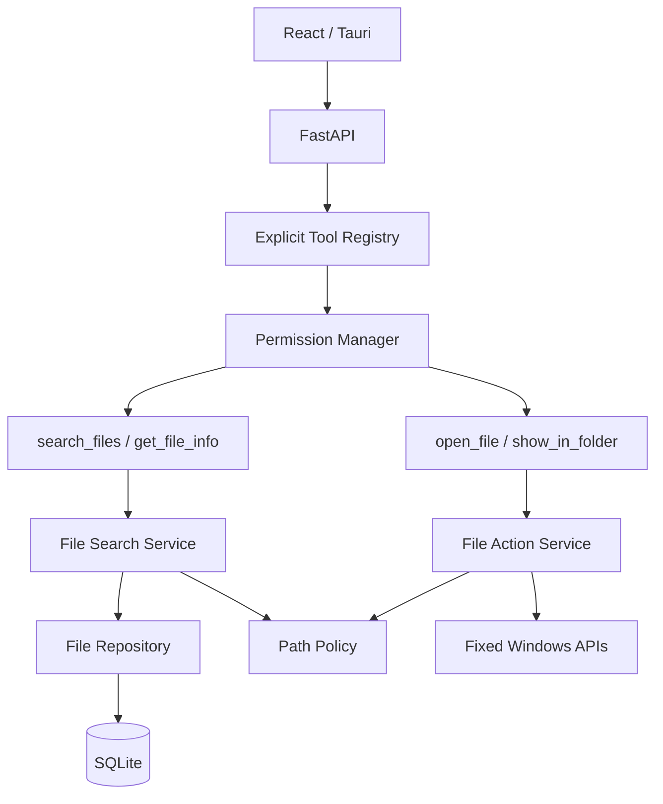
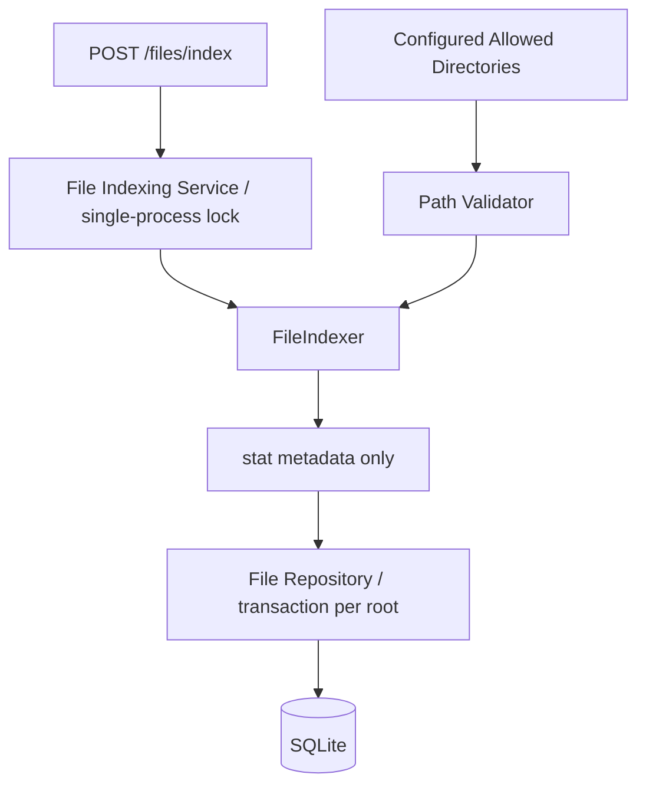
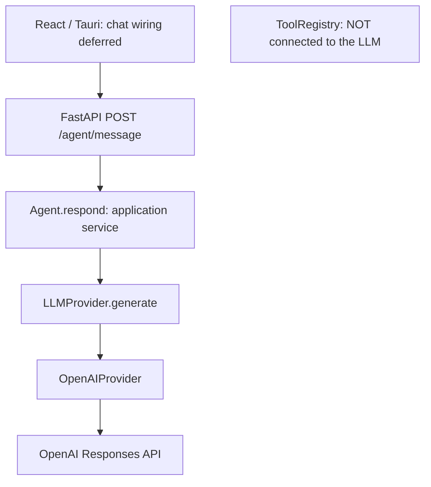

# Architecture

Feature 3.1 extends the existing boundaries with text-only BRAIN responses.
HANDS provides explicit file tools. GUARD controls execution and path access.
The LLM is not connected to HANDS or GUARD dispatch.

## Feature 3.1 provider boundary

The existing `Agent` is the application service; it receives only an `LLMProvider`,
adds Nova's system prompt, and converts a Nova-owned `LLMReply` into `AgentResponse`.
`generate(message, system_prompt=...)` has no tool input. SDK objects and error types
stay in `services/llm/openai_provider.py`. The existing `tool_call` reply placeholder
is rejected if populated; API `result` and `pending_action` remain null.

`create_app` composes one provider and agent per application lifespan, accepts an
injected provider for tests, and closes it on shutdown. The async SDK client is
created lazily on the first configured AI request and reused. No network call or
API key is needed at startup. Settings own model, timeout, and output limits.
There is one request, no retries, no agent loop, no conversation IDs or history.
The Responses payload contains only model, instructions, input, max_output_tokens,
and store=False. No tools, files, database objects or registry descriptions are sent.

The route validates JSON/origin, with a path-scoped 128 KiB body middleware and
10,000-character Pydantic message limit. Provider-neutral failure categories map
to fixed HTTP `detail` messages. The provider logs timing and categories only.
SDK debug/body logging is suppressed. See README for settings and error statuses.

## Composition and reuse

The FastAPI application factory owns settings and composes repositories, PathPolicy,
FileIndexer, FileIndexingService, FileSearchService, and FileActionService at startup.
Tools receive those same services. HTTP search and the future AI search_files tool
therefore share one implementation. SQL stays in database modules.

The agent/provider stubs now support text generation. The speech interface remains
a stub. No LLM loop or voice implementation is added. The only registered tools
are calculate, search_files, get_file_info, open_file, and show_in_folder.

## Guard and user interaction

READ tools execute after schema validation. INTERACTIVE tools return a pending
proposal unless dispatch receives trusted `user_initiated=True`. Only fixed
open/reveal HTTP handlers set this flag; it is not a ToolCall argument and cannot
bypass WRITE policy. The user's click is the explicit action authorization in this
phase. WRITE remains pending and DESTRUCTIVE denied. No general confirmation
endpoint exists.

Open/reveal accept stable file IDs, retrieve indexed paths, validate existence and
policy, then invoke two isolated Windows capabilities. Open uses os.startfile with
a fixed open verb and a supported-extension allowlist. Reveal uses SHParseDisplayName
and SHOpenFolderAndSelectItems, not Explorer command-line strings. Both record
request intent in actions before OS dispatch; launch failures are recorded separately.

## Index lifecycle

The index API accepts no caller-selected root. Configured roots are deduplicated
and overlapping children are collapsed. Indexing is manual, synchronous in a FastAPI
worker thread, and serialized with an application-owned lock. Run one Uvicorn worker.
Concurrent refresh gets 409. Search remains available while scanning.

FileIndexer uses an iterative scandir stack. Every traversed path passes centralized
validation; links/reparse points and system paths are skipped. It collects stat
metadata only, excludes Nova's database and SQLite journal files, and never opens
file contents. Failed entries/subtrees are tracked, not silently interpreted as
deletions. A failed root leaves its database records untouched.

One root snapshot and its previous rows are held in memory. One database transaction
per root bulk-upserts records and deletes stale metadata, excluding failed subtrees.
Stale membership uses sets and path ancestry, not pairwise file comparisons.
Unchanged means stored metadata is identical, ignoring the refreshed indexed_at.
Renames get new identities; deletion never deletes a file on disk.
Partial root failures return warnings; complete failure is HTTP 503.

## Database version 2

Startup performs a transactional v1-to-v2 files-table migration. Existing file IDs
and the actions table are retained; a future schema version is rejected.

- Existing metadata fields remain.
- IDs become INTEGER PRIMARY KEY AUTOINCREMENT to avoid stale ID reuse.
- name_key stores Unicode casefolded names for deterministic matching/sorting.
- root_path records the most recent indexing owner.
- path remains unique and uses native canonical paths (case-normalized on Windows).
- Indexes support name sort, extension, modified_at, size, and root_path; the unique
  path index also supports directory range queries.

Repository refresh works by path containment, so reconfiguring overlapping roots
does not duplicate files. Search is parameterized, sort SQL comes from a closed
mapping, and count/page are read in one snapshot transaction. A SQLite callback
checks current path policy before both counting and returning candidates. Search
does no directory enumeration or content reads, though validation performs metadata
checks for candidate paths.

Arbitrary filename substrings use instr over casefolded names; this is a scan of
matching candidates rather than a full-text index. Pagination bounds payload size.
Revoked roots are hidden immediately after restart, even if their rows remain.

## Frontend

Home retains the Nova header, backend status, and disabled future AI command bar.
FileSearch adds a filename form, extension filter, six sorts, page navigation,
refresh statistics, loading/error/empty states, and file cards.
The existing centralized api.ts performs all HTTP calls and supplies the required
file-request header. Formatters handle bytes and locale dates for presentation.
Buttons are disabled during requests; refresh completion reruns the current search.
There is no simulated progress and no filesystem access from React. Tauri starts
the managed backend child and exposes only a restricted command that returns a
per-launch session credential to the main window.

## Platform and deployment limits

Windows Open/Reveal passes through `permissions/windows_handles.py` before native
dispatch. Metadata handles pin each ancestor and target, deny write/delete sharing,
and verify the handle's final path and reparse attributes. They remain held through
dispatch and close on every exit. This does not bind asynchronous viewer access
after dispatch, and does not change the indexer's path-based scanning.

Windows APIs must run in the Windows-native Python process. Linux/WSL open/reveal
return 501, with no shell fallback or path translation. The Tauri host starts
the backend through `backend/managed.py`, owns its lifetime, and exposes only the
`backend_session` command to the trusted main window. Windows GUI behavior must
be tested on Windows; Linux tests mock the OS boundary.

No ORM, background watcher, user login system, or new frontend dependency was
introduced. OpenAI is the optional external text-generation service.
